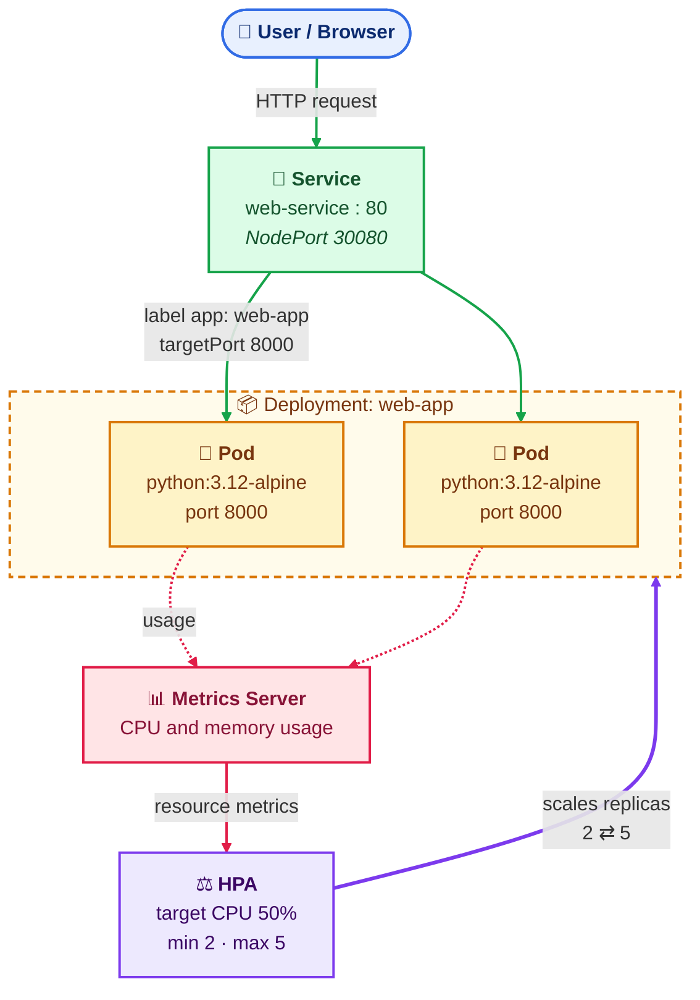
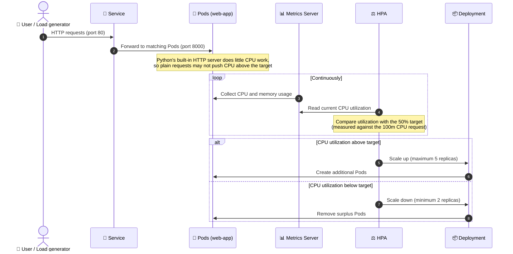
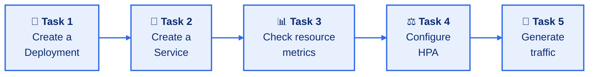

#  Kubernetes Capstone Project: Deploy and Auto-Scale a Web Application

> **Hands-on lab:** deploy a Python web server on Kubernetes, expose it with a Service, measure it with Metrics Server, and let the Horizontal Pod Autoscaler add Pods when demand grows.

| 🎯 Level | ⏱️ Suggested duration | 👥 Mode |
| :---: | :---: | :---: |
| **Beginner** | **60 minutes** | **Individual or pairs** |

### 📑 Contents

| # | Section | Audience |
| :-: | :-- | :-- |
| 1 | [🏢 Business scenario](#business-scenario) | Everyone |
| 2 | [🧰 Prerequisites](#prerequisites) | Everyone |
| 3 | [🏗️ Architecture](#architecture) | Everyone |
| 4 | [📝 Participant assignment](#participant-assignment) | Participants |
| 5 | [🛠️ Trainer reference solution](#trainer-reference-solution) | Trainer |
| 6 | [⏱️ Trainer session plan](#trainer-session-plan) | Trainer |
| 7 | [❓ Questions for participants](#questions-for-participants) | Participants (answer guide: Trainer) |
| 8 | [🏆 Evaluation rubric](#evaluation-rubric) | Trainer |
| 9 | [✅ Final verification checklist](#final-verification-checklist) | Trainer |
| 10 | [🧹 Cleanup](#cleanup) | Everyone |

---

## 🏢 1. Business scenario

> Imagine your company has launched a simple website where customers can view product information. Initially, two application instances are enough. During a promotional campaign, however, the number of visitors may increase.
>
> The company wants the application to remain available and handle increased demand without an administrator manually creating additional Pods.

**You are the Kubernetes administrator responsible for deploying the application.**

### 🎯 Your objectives

1. 🐍 Deploy a **Python HTTP Server** inside Kubernetes.
2. 📦 Run **two application replicas** using a **Deployment**.
3. 🔀 Expose the application through a **Service**.
4. 📏 Configure **CPU and memory requests and limits**.
5. 📊 Verify resource usage using **Metrics Server**.
6. ⚖️ Configure **Horizontal Pod Autoscaler (HPA)** to scale between **two and five replicas** based on CPU utilization.
7. 🚀 **Generate traffic** and observe whether Kubernetes increases the number of Pods.

---

## 🧰 2. Prerequisites

- [ ] A working Kubernetes cluster, such as **Minikube** or a training cluster.
- [ ] `kubectl` configured for the cluster.
- [ ] **Metrics Server** installed and working.
- [ ] Basic understanding of Pods, Deployments, Services, resource requests/limits, and HPA.

---

## 🏗️ 3. Architecture

**Legend:** 🟢 request traffic · 🔴 metrics flow · 🟣 scaling decisions

| Component | Role |
| :-- | :-- |
| 🔀 **Service** | Provides a stable endpoint and forwards traffic to matching Pods. |
| 📦 **Deployment** | Maintains the desired replica count. |
| 📊 **Metrics Server** | Provides resource metrics. |
| ⚖️ **HPA** | Uses those metrics to decide whether to change the replica count. |

### 🔄 How the pieces work together

> 💡 HPA calculates CPU utilization **relative to the requested CPU**, which is why CPU requests must be configured for autoscaling to work.

---

## 📝 4. Participant assignment

> [!NOTE]
> Initially, participants should receive the requirements below, **not** the completed YAML files. Ask them to create the files independently before checking the reference solution.

### 🧩 Task 1 — Create a Deployment

Create a Deployment named `web-app` with these requirements:

| Setting | Requirement |
| :-- | :-- |
| Container image | `python:3.12-alpine` |
| Command | Run Python's built-in HTTP server on port `8000` |
| Replicas | `2` |
| CPU request | `100m` |
| CPU limit | `200m` |
| Memory request | `64Mi` |
| Memory limit | `128Mi` |

✅ **Verify** the Deployment and Pods.

### 🔀 Task 2 — Create a Service

Create a Service named `web-service` with these requirements:

| Setting | Requirement |
| :-- | :-- |
| Type | `NodePort` |
| Service port | `80` |
| Target port | `8000` |
| NodePort | `30080` |
| Pod selector | Label `app: web-app` |

✅ **Verify** the Service and its endpoints.

### 📊 Task 3 — Check resource metrics

- Run `kubectl top nodes`.
- Run `kubectl top pods`.
- Confirm CPU and memory usage is reported.
- Identify the resource requests and limits in the Deployment.

### ⚖️ Task 4 — Configure HPA

Configure HPA for Deployment `web-app`:

| Setting | Requirement |
| :-- | :-- |
| CPU utilization target | `50%` |
| Minimum replicas | `2` |
| Maximum replicas | `5` |

✅ **Verify** HPA status and events.

### 🚀 Task 5 — Generate traffic

- Generate repeated HTTP requests to `web-service`.
- Watch HPA metrics and Pod count.
- Record whether the replica count changes.
- If scaling does not happen, inspect CPU utilization, metrics, and HPA events.

### 📬 Submission requirements

Submit:

- [ ] `web-app.yaml`
- [ ] `service.yaml`
- [ ] HPA creation command **or** HPA YAML
- [ ] Output or screenshots from `kubectl get pods`, `kubectl get svc`, `kubectl top pods`, and `kubectl get hpa`
- [ ] A short explanation of how the Deployment, Service, resource settings, Metrics Server, and HPA work together

---

